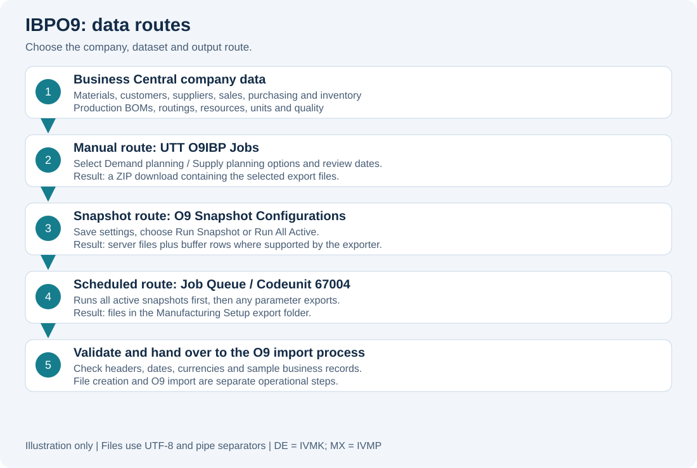
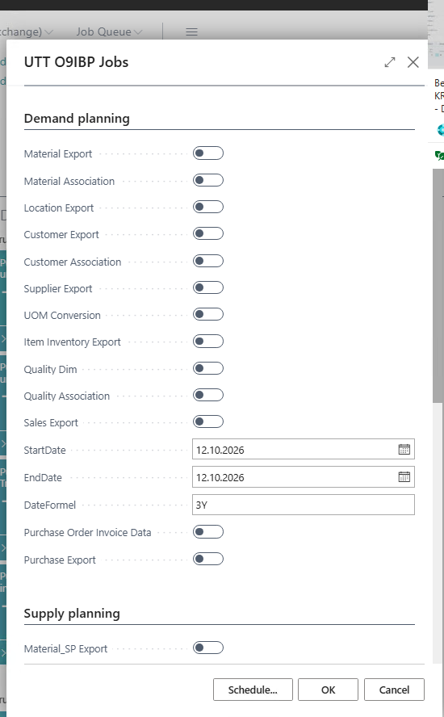
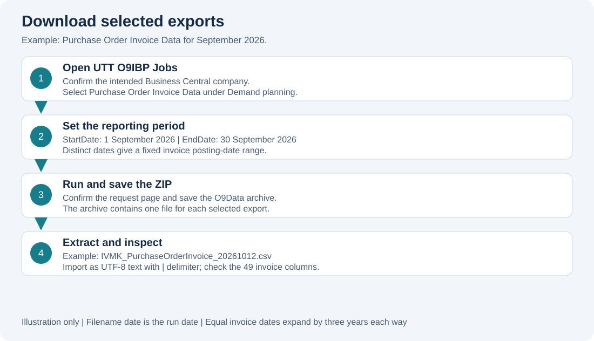
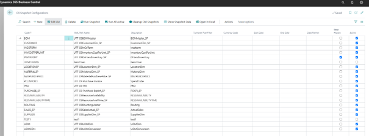
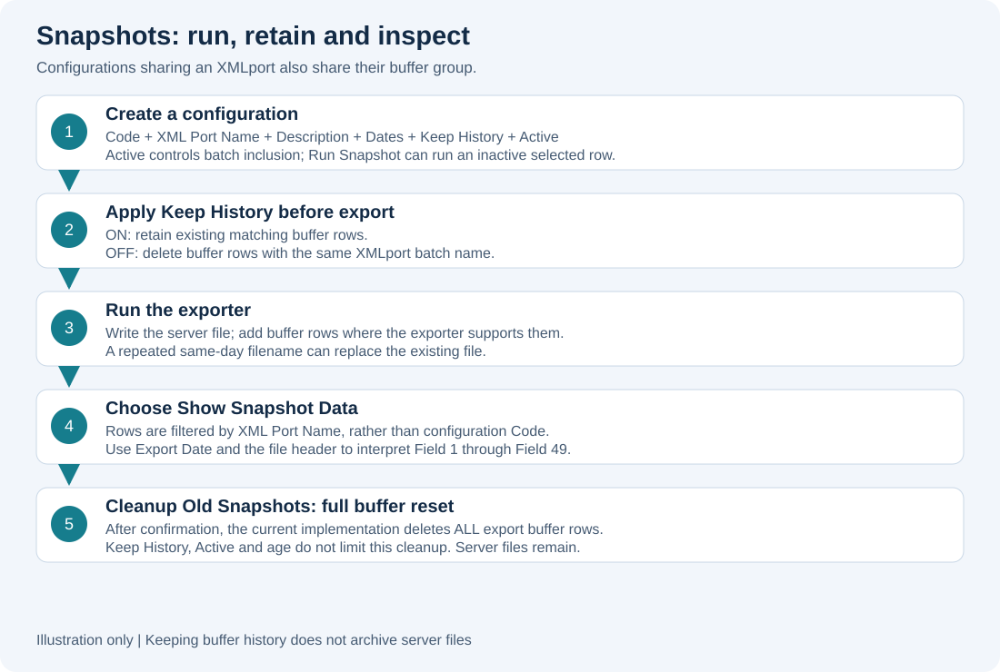
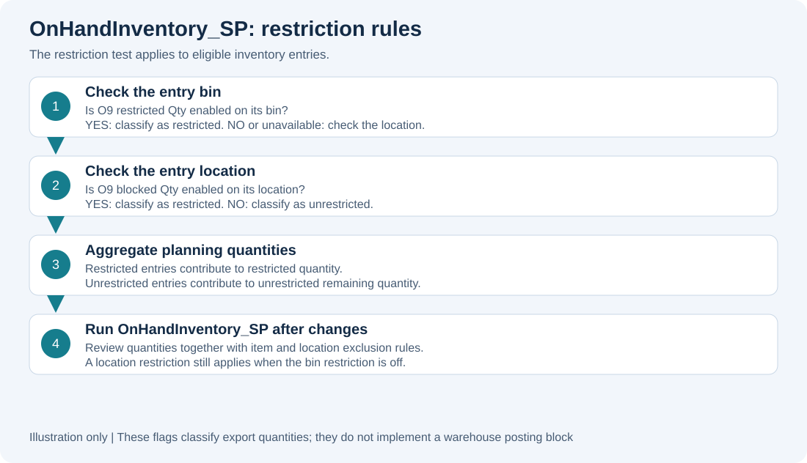
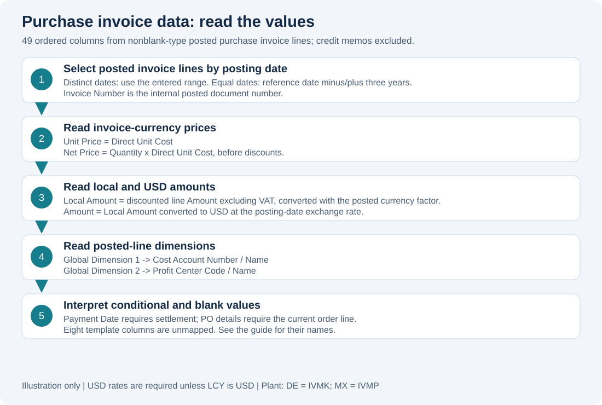

# IBPO9 user guide

Business Central exports and snapshots for O9 demand and supply planning

Prepared 12 October 2026 from extension version **18.5.26.10120825**. This guide covers the whole project in this repository. The application name is **IBPO9**; no separate application named “wohl” was identified.

This guide includes workflow diagrams and two user-provided Business Central screenshots. Page labels can differ with the Business Central language and installed translations. Procedures were checked against the source code; execution in a live company has not been verified.

## Contents

1. [Purpose and navigation](#purpose-and-navigation)
2. [Initial setup](#initial-setup)
3. [Download a manual export](#download-a-manual-export)
4. [Choose the export functions](#choose-the-export-functions)
5. [Understand date ranges](#understand-date-ranges)
6. [Create and inspect snapshots](#create-and-inspect-snapshots)
7. [Schedule exports](#schedule-exports)
8. [Classify restricted inventory](#classify-restricted-inventory)
9. [Use purchase invoice data](#use-purchase-invoice-data)
10. [Supporting reports](#supporting-reports)
11. [Check results and solve problems](#check-results-and-solve-problems)

## Purpose and navigation

IBPO9 extracts company data from Business Central for O9 planning. It covers master data, relationships, sales, purchasing, inventory, production structures, resources and quality. The extension produces files; delivery to or import into O9 is a separate operational step.

Use Business Central search (Tell Me) to find these entries:

| Entry | What you use it for |
| --- | --- |
| **UTT O9IBP Jobs** | Select exports and download a ZIP. Internal report name: UTT O9 Project Jobs. |
| **O9 Snapshot Configurations** | Save export configurations, run them and inspect stored results. |
| **UTT IBPO9 Buffer List** | View stored export columns, batch names and export dates. |
| **Manufacturing Setup** | Set the server export folder in IBPO9ExportPath. |
| **Location Card**, group **IBP O9** | Set O9 blocked Qty for a location. |
| **Bins** | Set O9 restricted Qty for a bin. |
| **Job Queue Entries** | Administrator setup for recurring exports. |

Select the correct company before running an export. Country DE maps to the legal entity **IVMK**; MX maps to **IVMP**. Other country codes produce a blank legal entity prefix in the current implementation.

## Initial setup

An administrator should confirm that IBPO9 and its dependencies are installed and users can run the relevant reports and pages. The manifest targets Business Central on premises, application 18.5. Required dependent extensions include KUMAVISION textile, KUMAVISION factory, Quality Management Extension, KVS Anpassungen and EDX.

For snapshots and scheduled files:

1. Open **Manufacturing Setup**.
2. Enter the intended server folder in **IBPO9ExportPath**. Include a trailing directory separator because the implementation appends the filename directly, for example `\\server\share\O9\IVMK\`.
3. Confirm the folder exists and the Business Central server service account can write to it.
4. Agree on a separate folder per company and on the team or process that collects files for O9.

A manual ZIP download uses the browser download flow. Snapshot and job queue exports use the configured server folder.

Before purchase invoice exports, check the local currency code and USD currency/exchange rates. Unless the local currency is USD, the export needs posting-date USD rates to calculate its Amount column.

## Download a manual export

**Screenshot: O9 Jobs request page.** Select datasets using the switches, review StartDate, EndDate and DateFormel, then choose **OK** to run the manual export. Scroll down to see the remaining Supply planning options. The screenshot shows both dates as 12 October 2026 and the formula as 3Y; for purchase invoices, these equal dates produce a three-year range before and after the reference date. All visible export switches are off, so select the required dataset before running.

1. Search for **UTT O9IBP Jobs** and open it.
2. Select the required checkboxes under **Demand planning** and **Supply planning**.
3. Review **StartDate**, **EndDate** and **DateFormel**. The initial dates are the Business Central work date and the initial formula is three years.
4. Run the report with the request page confirmation action.
5. Save the downloaded ZIP whose name begins with **O9Data**.
6. Extract the archive and check that each requested dataset is present.
7. Validate the contents before handing the files to the O9 import process.

Example: for posted purchase invoices from 1 September to 30 September 2026, select **Purchase Order Invoice Data**, enter those distinct start and end dates, and run the report. In a DE company, the archive contains `IVMK_PurchaseOrderInvoice_20261012.csv` when run on 12 October 2026.

Files have a `.csv` extension but use **pipe (`|`) separators** and **UTF-8** encoding. Import them into Excel as delimited text using `|` as the delimiter; preserve identifiers as text to avoid losing leading zeros. Do not assume comma-separated content.

## Choose the export functions

Use the variant required by your O9 interface. DP means demand planning; SP means supply planning. The similarly named variants have different output contracts.

| Demand planning option | Business purpose |
| --- | --- |
| Material Export | Item/material master data. |
| Material Association | Relationships between materials. |
| Location Export | Planning location master data. |
| Customer Export | Customer master data. |
| Customer Association | Customer relationships. |
| Supplier Export | Vendor/supplier master data. |
| UOM Conversion | Unit of measure conversion data. |
| Item Inventory Export | Item inventory KPI data. |
| Quality Dim | Quality master data. |
| Quality Association | Quality relationships. |
| Sales Export | Sales data prepared by the sales buffer calculation. |
| Purchase Order Invoice Data | Posted purchase invoice lines in a 49-column template. |
| Purchase Export | Purchase order KPI data. |

| Supply planning option | Business purpose |
| --- | --- |
| Material_SP Export | Supply planning material master data. |
| UOM Conversion | The same conversion selection used in demand planning. Both checkboxes share one value. |
| Location_SP Export | Supply planning locations. |
| Customer SP Export | Supply planning customer data. |
| Supplier SP Export | Supply planning supplier data. |
| Resource Master | Production resource master data. |
| Resource Availability | Resource availability data. |
| Resource Availability Time | Resource availability time data. |
| BOM Master | Production bill of materials. |
| Routing Master | Production routings. |
| Pro | Production order data. |
| Incoterm | Incoterm data prepared through the sales buffer. |
| ActualSales_SP | Supply planning sales output; its file label is cust_orders. |
| OnHandInventory_SP | On-hand inventory with restriction classification. |
| Purchase Export SP | Supply planning purchase order KPI data. |
| InventoryCostPerUnit | Inventory unit cost data. |

Some XMLports exist without a manual report checkbox, including standalone UOM, application datasets, stock transfers and material purchase prices. Their availability through a snapshot depends on the XMLport implementation. Ask the interface owner which datasets are approved for your integration.

## Understand date ranges

Date settings are interpreted differently by each export. A date formula does not universally replace the start and end dates, despite the snapshot page tooltip.

| Export | Effective date range |
| --- | --- |
| Sales Export, ActualSales_SP, Incoterm | Start reference minus the formula through end reference plus the formula. A blank formula defaults to three years. |
| Purchase Export | Distinct reference dates are used directly. Equal reference dates expand to one year before and one year after that date. |
| Purchase Export SP, Purchase Order Invoice Data | Distinct reference dates are used directly. Equal reference dates expand to three years before and three years after that date. |
| Pro | Distinct reference dates are used directly. Equal reference dates expand to one year before and after. |
| Other datasets | Do not assume the shared dates filter them. Master data and inventory exports use their own selection rules. |

Blank reference dates default to the Business Central work date. File names use the actual current date, which may differ from the work date.

**Equal dates are not a one-day invoice export.** For an invoice reference date of 12 October 2026 entered in both fields, the range becomes 12 October 2023 through 12 October 2029. Review row posting dates to confirm the intended period. A narrow sales export also needs careful formula selection because the sales range expands even when the reference dates differ.

## Create and inspect snapshots

A snapshot configuration saves an export selection and its date settings. Running it writes a file to the server folder and, where the selected exporter supports it, stores rows in the export buffer.

**Screenshot: O9 Snapshot Configurations.** Each row selects an XMLport and its export settings. The action bar includes **Run Snapshot**, **Run All Active**, **Cleanup Old Snapshots** and **Show Snapshot Data**. **Keep History** and **Active** are at the right of the list. Select the intended row before running or inspecting a snapshot. The screenshot is a page overview; consult the field descriptions below for details.

1. Open **O9 Snapshot Configurations** and add a row.
2. Enter a unique **Code**, for example `POINV-MONTH`.
3. Use the **XML Port Name** lookup to choose the intended exporter. For invoices select `UTT O9 Purchase Invoice`.
4. Enter a meaningful **Description**, for example `PurchaseOrderInvoice_September`. The description forms part of the output filename; use filename-safe characters.
5. Set **Start Date**, **End Date** and **Date Formel** using the date rules above.
6. Choose **Keep History** according to the retention requirement.
7. Select **Active** if the configuration should run in the all-active batch and job queue.
8. Select the row and choose **Run Snapshot**.
9. Choose **Show Snapshot Data** and check **Export Date** and the exported columns. Check the server folder separately for the file.

**Run Snapshot** runs the selected row even if Active is off. **Run All Active** runs every row with Active on, in the current company.

| Configuration field | Meaning in this implementation |
| --- | --- |
| Code | Unique configuration identifier, entered manually. |
| XML Port Name | Exact export object name selected from the lookup. |
| Description | Human-readable label and server filename component. |
| Start Date / End Date / Date Formel | Reference values interpreted by the selected export. |
| Keep History | Keeps existing buffer rows when on; deletes matching batch rows before an export when off. |
| Active | Includes the configuration in Run All Active and scheduled snapshot processing. |
| Turnover Plan Filter / Currency Code | Present on the page, but not passed to exporters by RunSnapshot. Do not rely on them to change this export. |

History is grouped by **XML Port Name**, not configuration Code. Configurations using the same XMLport share their buffer group. A run with Keep History off can remove rows created by another configuration using that exporter. Show Snapshot Data likewise shows the shared group.

The buffer uses generic headings **Field 1** through **Field 49**. Their meaning depends on the export column order. Use the corresponding file header or mapping documentation. Stored field values have a 100-character limit, so the buffer may contain shortened values compared with the file.

**Cleanup Old Snapshots deletes every row in the UTT IBPO9 Buffer after confirmation.** It does not filter by age, Active or Keep History. The page tooltip understates its scope. Use this action only when a full buffer reset is intended. It does not delete server files. Keeping buffer history also does not preserve multiple same-day files: repeating an export with the same filename can replace the existing server file.

## Schedule exports

An administrator can schedule **Codeunit 67004, UTT O9 Project Lib**, in **Job Queue Entries**, in the intended company. Configure recurrence and inspect the job queue log after the first run.

Every execution first runs **all active snapshot configurations**, even with an empty Parameter String. Parameter exports then run additionally. For predictable date ranges and filenames, configure the required active snapshots and leave the parameter string empty.

For a dedicated additional invoice export, use the exact parameter **PO_INVOICE**. This produces a server file named `<entity>_PurchaseOrderInvoice_<YYYYMMDD>.csv`. This parameter route uses default reference dates and therefore the invoice range of work date minus/plus three years. It does not take a monthly range from a snapshot row.

Other recognized parameter strings include `MATERIAL`, `MATERIAL_SP`, `MATERIALASSOC`, `LOCATION`, `LOCATION_SP`, `SUPPLIER`, `SUPPLIER_SP`, `CUSTOMER`, `CUSTOMER_SP`, `CUSTOMER_ASSOCIATION`, `UOM`, `UOMCONV`, `SALES`, `SALES_SP`, `PURCHASE`, `PURCHASE_SP`, `INVENTORY`, `QUALITY`, `QUALITYASSOC`, `BOM_SP`, `ROUTING_SP`, `RessourceAvail_SP`, `RessourceAvailTime_SP`, `STO_SP`, `PRO_SP`, `OnHandInventory` and `InventoryCostPerUnit_SP`.

Parameter matching is case-sensitive substring matching, so `MATERIAL_SP` also triggers `MATERIAL`, and `SALES_SP` also triggers `SALES`. Some dispatch names differ between the outer matching logic and the export dispatcher, including routing and resource availability. Have the administrator verify actual files before relying on these parameter routes; use tested snapshot configurations where appropriate.

## Classify restricted inventory

To mark a whole location as restricted for the on-hand supply planning export, open its **Location Card**, expand **IBP O9** and enable **O9 blocked Qty**. To mark a bin, open **Bins** for the location and enable **O9 restricted Qty** for that bin.

For each eligible inventory entry, a restricted bin makes the quantity restricted. If the bin does not make it restricted, the location flag is checked. A restricted location therefore still restricts an entry whose bin flag is off. With both flags off, the quantity contributes to unrestricted remaining quantity.

Run **OnHandInventory_SP** again after changing these settings. These extension flags classify planning export quantities; the code shown here does not implement a warehouse posting block. The exporter also has item and location exclusion rules, so restriction flags alone do not guarantee a row appears in the output.

## Use purchase invoice data

The **Purchase Order Invoice Data** function exports posted purchase invoice lines whose Type is not blank. Credit memos are excluded. There is no plant filter. Expect 49 columns in a fixed order, including vendor, invoice, purchase order, material, quantity, price, currency, payment, company, dimensions, G/L and WBS information.

| Field or group | How to read it |
| --- | --- |
| Invoice Number | Internal posted invoice number. |
| Unit Price | Direct Unit Cost in invoice currency. |
| Net Price | Quantity × Direct Unit Cost, before discounts. |
| Local Amount | Invoice line Amount, excluding VAT and including discounts, converted to local currency using the posted invoice currency factor. |
| Amount | Local Amount converted to USD using the posting-date exchange rate, or Local Amount directly when LCY is USD. |
| PO Line Description / UOM PO | From the current purchase order line; blank if the order line no longer exists. |
| PO Payment terms | Posted invoice payment terms. Vendor Payment terms uses the current vendor record. |
| Payment Date | Vendor ledger closing date for a fully settled entry. Blank for an open entry; not the date of a partial payment. |
| Plant / Plant Name | IVMK for DE, IVMP for MX, otherwise blank. Both columns use the same value. |
| Incoterms | Posted invoice Shipment Method Code. Confirm its codes meet the receiving interface requirements. |
| Cost Account Number / Name | Global Dimension 1 value on the posted invoice line. |
| Profit Center Code / Name | Global Dimension 2 value on the posted invoice line. |
| G/L Account / description | Populated for explicit G/L Account lines. Item lines do not infer a posted expense account. |
| WBS Element / description | Job Task No. and associated job task description. |

The following columns are intentionally blank pending company-specific mappings: **Material Group, Material Group Name, Category, Sub-Category, Commodity, Segment, Contract ID, Cost Account Type**. Missing configured dimensions or dimension entries also produce blanks in their corresponding fields.

Material classification uses textile/BOM data and translation mappings. Material Category defaults to Flat Fabric when its translation is unavailable. For exact field sources and the 49-column contract, see [Purchase invoice mapping](../src/xmlport/PURCHASE_INVOICE_MAPPING.md).

## Supporting reports

**Purchase Order Qty Audit** appears with the caption **Einkaufsbestellungen – Mengenübersicht (Audit)**. It reads current purchase orders and item lines. Use the order number, vendor, order date and status filters to narrow the report. It shows ordered, received, invoiced, outstanding and received-not-invoiced quantities, plus cost/value and status information. The source does not read archived purchase orders.

The request page offers **Nur offene / teilweise gelieferte Zeilen** (only open/partially delivered lines), **Nur „Empfangen, nicht fakturiert“** (received, not invoiced only) and **Lieferantenfilter** (vendor filter). Verify the resulting selection before using it for reconciliation, particularly the option filters and totals; this guide does not certify report calculations.

**UTT Actual Sales** and **UTT 09 Incoterm** are processing reports used to prepare the shared sales buffer for their exports. Their request pages expose start and end dates. For the normal file workflow, use the matching O9 Jobs export selection or snapshot configuration. Sales and Incoterm preparation replaces the shared sales buffer; avoid overlapping runs that depend on it.

## Check results and solve problems

After each new configuration, confirm the company, file timestamp, filename, expected datasets, delimiter, row dates and a few known business records. For invoices, compare a sample posted invoice's quantity, currency and amounts and check dimensions against its posted line. Successful file generation alone does not establish successful O9 import.

| Symptom | Check or next action |
| --- | --- |
| Snapshot/job fails on IBPO9ExportPath | Populate Manufacturing Setup and check the folder, trailing separator and server service account permissions. |
| No downloaded file after Run Snapshot | Snapshots save server files. Check the configured folder; use O9 Jobs for a browser ZIP download. |
| File opens as one Excel column | Import UTF-8 delimited text with `|` as the delimiter. |
| Invoice range contains several years | Equal reference dates expand by three years each way. Use distinct dates for a fixed period. |
| Sales dates extend beyond entered dates | Sales applies the formula before the start and after the end. Review DateFormel. |
| Purchase invoice currency error | Check LCY and posting-date USD rates unless LCY is USD. |
| Blank invoice PO details | The original purchase order line may no longer exist. |
| Blank cost account/profit center | Check General Ledger Setup global dimension codes and posted line dimension values. |
| History disappears | A configuration sharing the XMLport may have Keep History off, or full buffer cleanup was run. |
| Buffer mixes runs | Filter by Export Batch ID and Export Date; configurations sharing an XMLport share the group. |
| Extra scheduled datasets | Every job runs active snapshots; substring parameters can trigger additional exports. |
| Empty/unexpected scheduled file | Check exact parameter spelling and dispatcher mismatch; validate a snapshot route. |
| Restricted stock still classified incorrectly | Check both location and bin flags, item/location exclusions and rerun OnHandInventory_SP. |
| Empty entity prefix or plant | Check Company Information Country/Region Code; only DE and MX have mappings. |

When reporting an issue, provide the company, extension version, selected export or snapshot Code, dates/formula, Keep History setting, filename and the exact error message. Include a sample document number and expected result where relevant.

## Documentation basis

The guide is derived from the project library, export report, snapshot page/table, location/bin extensions and XMLports in this repository. The source files remain authoritative. The user supplied the O9 Jobs and Snapshot Configurations screenshots in `images/Picture1.png` and `images/Picture2.png`. These screenshots show the interface; runtime permissions and end-to-end O9 imports have not been validated through a connected Business Central session.

Diagram assets are editable SVG images in [images](images/). The browser edition is [USER_GUIDE.html](USER_GUIDE.html) and can be printed to PDF from a browser.
